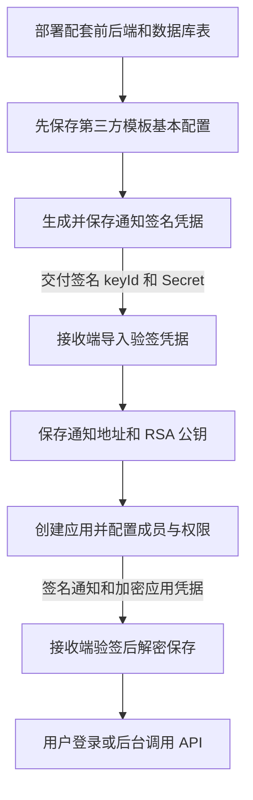

# 第三方业务应用接入说明

面向平台实施和运维。按下列步骤完成部署、模板配置、应用授权及通知验证。

- 实现接口、验签和登录：[开发指南](第三方业务应用开发指南.md)。

## 1. 两种访问身份

| 场景 | 使用身份 | 权限来源 |
| --- | --- | --- |
| 用户登录第三方、代表用户操作 | 用户委托 Token | 当前用户功能权限与应用许可的交集，并保留用户数据限制和应用 Scope |
| 定时任务、后台同步 | 业务应用 Token | 实例自身的功能及资产授权，不继承创建人权限 |

本文的业务应用模板通知，不等于开放平台 API 应用订阅。API 应用订阅仍使用 Client ID / Client Secret 签名；其创建人数据身份规则不套用到业务应用。

## 2. 配置流程



## 3. 平台配置

```yaml
application:
  api:
    enabled: true
    key-ring:
      1: ${APPLICATION_API_KEY_SLOT_1}
    active-key-slot: 1
```

- 主密钥由部署系统安全注入，每个值至少 32 个 UTF-8 字节。**升级时保留现有主密钥，不要覆盖原槽位材料。**
- 新版不再读取 `application.api.webhook-keys`，不再逐模板配 YAML，也不回退旧密钥。
- 首次上线部署支持动态通知凭据的前后端，并按现场数据库升级流程确认 `s_business_app_notify_key` 表已创建。以后生成、查看、重置模板凭据无需重启平台。
- 所有取钥和签名节点共享数据库，取钥走可见最新提交的主库；同一密钥槽位在各节点的材料必须一致。每次签名读取当前记录，不增加 Redis 或节点本地凭据缓存。
- 凭据固定记录其主密钥槽位，切换活动槽位不会改变已有 Secret。旧槽位须保留至相关应用凭据、模板通知凭据完成轮换，且关联 Code/Token 已过期。
- OAuth2 Code 单次消费仍需共享 Redis，与通知凭据存储分开配置。

平台对外 API 地址应可被接收端访问并保留网关前缀；生产使用 HTTPS。集群节点需保持时钟同步。

## 4. 创建模板并配置通知

### 4.1 页面操作

1. 接收方准备至少 2048 bit RSA 密钥对，提供接收 keyId、SPKI 公钥、通知 URL 和登录回调 URL；私钥不交给平台。
2. 新建 `provider=third-party` 模板，先保存名称、跳转地址等基本配置，不提交 `configuration.notification`。
3. 进入“应用模版 → 对应模板 → 配置”，打开“签名通知”，先点击“通知签名凭据 → 生成并保存”，暂不提交普通表单。
4. 把弹窗中的通知 keyId/Secret 安全交给接收方，同时确认 platformId 和模板 ID。接收方导入后，在模板中填通知地址、RSA 接收密钥 ID 和公钥，再保存普通配置。
5. 接收服务就绪后创建应用实例；已有实例可点击“同步接入信息”发送当前凭据。

**凭据操作独立保存**，不会保存或撤销普通表单草稿。普通模板查询不返回 Secret；查看和重置需模板保存权限。关闭通知或修改普通配置不会重置凭据。

### 4.2 配置字段

| 字段 | 用途 |
| --- | --- |
| `platformId` | 平台来源标识，未配置时为模板 ID；已有应用后不能改变有效值 |
| `redirectUri` | 第三方登录回调地址；保留参数 `code/platformId/applicationId` 由平台提供 |
| `externalParameters` | 可选跳转提示参数，支持 fixed 或 user，用户字段仅 id、username；不能作为登录凭据 |
| `notification.address` | 平台服务端可达的接收 URL |
| `notification.keyId/publicKey` | **RSA 接收 keyId、公钥**，用于加密交付应用 AccessSecret |
| 页面“通知签名凭据” | **HMAC keyId、Secret**，独立管理，不放入 configuration |

以下是生成签名凭据后保存的配置片段，不是首次创建模板的请求：

```json
{
  "platformId": "partner-prod",
  "redirectUri": "https://partner.example.com/login/callback",
  "notification": {
    "address": "https://partner.example.com/jetlinks/events",
    "keyId": "partner-rsa-01",
    "publicKey": "-----BEGIN PUBLIC KEY-----\n<RSA SPKI公钥>\n-----END PUBLIC KEY-----"
  }
}
```

不同环境若复用相同应用 ID，应设置不同 platformId。接收方按 `(platformId, applicationId)` 保存应用，不按 URL 区分身份。平台主密钥、模板内部 `secureKey` 不交付第三方。

## 5. 创建应用与授权

创建实例、启用模板和应用，再绑定允许进入的用户。用户自身须为启用状态；锁定用户不能进行外部用户授权。

```http
POST /business-application/{applicationId}/users/_bind
Content-Type: application/json

["user-001", "user-002"]
```

上述及下文管理接口使用平台管理员身份，不使用第三方应用 Token。

功能权限和数据权限分别配置：

| 配置 | 作用 |
| --- | --- |
| 模板菜单/按钮与 API Group | 应用功能许可上限，两种来源可以单独使用或组合 |
| 实例 `configuration.authorization.inherit` | 继承模板许可；设为 false 后使用实例显式许可，并受模板上限约束 |
| 实例资产绑定及 Group 资产访问规则 | 限定可访问哪些设备等数据；功能继承不会继承模板资产 |
| 应用成员 | 限定哪些用户可进入应用，不代替接口或数据授权 |

显式模式下尚无实例菜单/Group 授权时，功能许可为空。Group 写入为全量替换，`[]` 清空 Group，不清除菜单授权；切换继承模式不自动删除已有实例授权。

常用授权入口：

| 操作 | 接口 |
| --- | --- |
| 保存继承模式等实例配置 | `PATCH /business-application` |
| 模板菜单授权 | `PUT /menu/business_application_template/{templateId}/_grant` |
| 实例菜单授权 | `PUT /menu/business_application/{applicationId}/_grant` |
| 模板 Group 授权 | `PUT /open/api/group/business_application_template/{templateId}/_grant` |
| 实例 Group 授权 | `PUT /open/api/group/business_application/{applicationId}/_grant` |
| 绑定/解绑资产 | `POST /assets/bind/{assetType}`、`POST /assets/unbind/{assetType}` |

绑定设备示例，目标是业务应用实例维度：

```json
[
  {
    "targetType": "business_application",
    "targetId": "partner-app-001",
    "assetIdList": ["device-001", "device-002"],
    "allPermission": true
  }
]
```

功能授权、资产访问规则、AssetsHolder 和强制 Scope 同时生效。成功拿到 Token 不代表可读全部数据；用户委托即便来自超级管理员，也受应用功能上限约束。不能靠改 Header、重发 Token 或换成后台身份绕过用户权限。

## 6. 通知凭据管理与升级

管理入口：`/business-application-template/{id}/notification-signature`。

| 操作 | 方法及后缀 | 权限与结果 |
| --- | --- | --- |
| 查询状态 | GET，无后缀 | 模板 query；仅 configured、keyId |
| 首次生成 | POST `/_generate` | 模板 save；返回 keyId、secret，已有记录拒绝覆盖 |
| 主动查看 | POST `/_reveal` | 模板 save；返回当前 keyId、secret |
| 重置 | POST `/_rotate` | 模板 save；原子替换并返回新 keyId、secret |

敏感响应带 `Cache-Control: no-store`，关闭平台访问日志采集；网关也不要记录响应正文。专用表只存 keyId、槽位和随机种子，不存可直接使用的 Secret；普通配置、通知、任务和日志不携带通知 Secret。删除模板时同步清理凭据。

重置会影响模板下所有应用：后续签名及失败重试读取新密钥，已取钥的在途请求可能仍用旧值。接收方同步替换 keyId/Secret；无双密钥宽限期，不承诺无缝切换。

**旧 YAML 模板升级：**保留原模板、通知地址和 RSA 配置，部署新版后在原模板页生成新通知凭据，再更新接收端。没有自动迁移或 YAML 回退；部署到完成换钥之间可能暂停投递，应安排窗口。

Python 接收示例每次验签重新读取受保护的本地配置。平台换钥后，接收方更新配置中的 keyId/Secret 即生效，无需重启；平台和接收端不会自动同步密钥。操作见[开发指南的本地联调](第三方业务应用开发指南.md#6-本地联调)。

## 7. 投递、补发与凭据恢复

- 业务模板通知默认最多尝试 5 次（含首次），以实际投递策略为准；不要与 API 订阅的 24 小时阶梯重试混淆。
- 2xx 表示接收成功；408、429、5xx 可有限重试，其他 4xx 为永久拒绝。通知可能重复、乱序，不保证最终成功。
- 通知签名重置只换验签凭据，不重置任务次数或自动回放全部历史事件。
- 应用凭据丢失、先建应用后配通知时，使用“同步接入信息”；它发送当前凭据和 API 地址，不改变 AccessKey、revision 或启停状态。
- 怀疑应用 AccessSecret 泄漏时才轮换应用凭据。它与通知 HMAC 重置是两种操作，RSA 接收密钥也是独立配置。

| 操作 | 接口 |
| --- | --- |
| 同步当前应用凭据 | `POST /business-application/{id}/credential/_sync` |
| 轮换应用凭据 | `POST /business-application/{id}/credential/_rotate` |
| 查询模板投递任务 | `POST /business-application-template/{id}/delivery/tasks/_query` |
| 查询模板投递记录 | `POST /business-application-template/{id}/delivery/records/_query` |
| 人工重投失败任务 | `POST /business-application-template/{id}/delivery/tasks/{taskId}/_requeue`，正文含 expectedAttempt |

投递查询使用模板 query 权限，重投使用模板 save 权限。重投要求当前模板可投递、任务为 dead 且 attempt 匹配；保留累计次数和原事件内容，不生成新应用凭据，签名仍取当前通知密钥。任务查询不返回原始正文，记录也不代表接收端已完成业务处理。

## 8. 验收与排查

按顺序验证：**收到并验签通知 → 解密保存应用凭据 → 用户登录 → 后台调用 → 权限收窄生效**。集群另确认不同节点均可使用新通知 keyId；不要直接在正式模板上做无准备的重置测试。

| 现象 | 检查 |
| --- | --- |
| 找不到签名凭据区域 | 配套运行时前端、第三方模板、配置页“签名通知”开关和模板保存权限 |
| 保存通知配置失败 | 是否已先生成并保存凭据 |
| 旧 YAML 已配置但没有推送 | 新版不读 webhook-keys；检查专用记录、主密钥槽位、通知地址和投递任务 |
| 部分节点失败 | 是否共用主库、槽位材料是否一致、是否误走延迟从库 |
| 验签失败 | 通知 keyId/Secret 是否匹配、原始正文和完整签名头、时钟；不要混用 RSA keyId |
| 验签通过但解密失败 | RSA 接收 keyId、私钥与模板公钥，以及 OAEP/MGF1 SHA-256 |
| Token 有效但 403/空列表 | 当前用户/应用功能权限、实例资产规则、资产绑定及强制 Scope |
